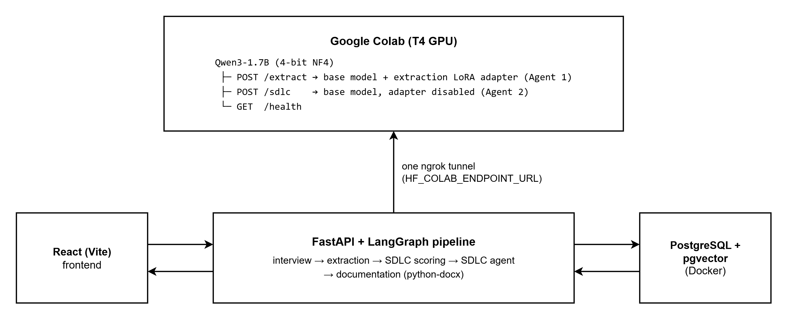
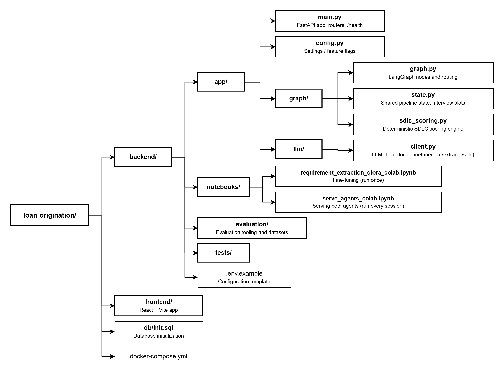

# Loan Origination Requirements System

An AI-assisted requirements engineering tool for a personal/consumer **loan origination system**. Stakeholders describe the project through a guided interview or a one-shot brief. The system extracts structured requirements, computes suitability scores for six SDLC methodologies, explains the scores, and generates an SRS and traceability matrix.

---

## Features

- **Two input modes**
  - **Guided interview:** the system asks questions across 17 requirement areas (slots).
  - **One-shot brief:** describe the whole project in one message and click *End description*.
- **Agent 1: Requirement Extraction.** A QLoRA fine-tuned **Qwen3-1.7B** model converts stakeholder input into structured business, functional, security and non-functional requirements, each with a priority, acceptance criteria, source slot and confidence.
- **Deterministic SDLC scoring.** A Python scoring engine rates the project on 9 factors and computes a suitability percentage for 6 methods: Agile, DevSecOps, Spiral, V-Model, Waterfall and Agile + DevSecOps Hybrid. The scores are transparent and reproducible.
- **Agent 2: SDLC Analysis.** The same open base model (with the extraction adapter disabled) explains why each method received its percentage and lists trade-offs and risks. It **never changes the scores**.
- **Fallback behavior.** If the SDLC endpoint is unavailable, Python scores remain available and the explanation is omitted. If extraction fails, the current pipeline falls back to placeholder stub requirements; check the audit log for the error.
- **Audit trail** of every pipeline step and agent call.
- **Document generation:** a Word-format SRS with requirements, the SDLC ranking, the factor evidence and the agent explanation.

---

## Architecture



**Pipeline flow for one run**

1. The frontend sends the stakeholder input to the backend.
2. The backend calls Colab `/extract` (Agent 1), which returns structured requirements.
3. Python `score_project` computes the 9 factor ratings and the 6 SDLC percentages locally.
4. The backend calls Colab `/sdlc` (Agent 2) with the requirements and percentages, which returns explanations and risks.
5. `documentation_node` builds the SRS Word document.

---

## Tech stack

| Layer | Technology |
|---|---|
| Frontend | React, Vite |
| Backend | Python, FastAPI, LangGraph, Pydantic Settings, SQLAlchemy |
| Database | PostgreSQL + pgvector (Docker) |
| Model | Qwen/Qwen3-1.7B, QLoRA (PEFT, bitsandbytes 4-bit) |
| Model serving | Google Colab + FastAPI + ngrok |
| Documents | python-docx |

---

## Project structure

---

## Prerequisites

- Python 3.10+
- Node.js 18+ and npm
- Docker Desktop
- A Google account with Colab access. Its Google Drive must contain the trained adapter at:
  `MyDrive/loan-origination/qwen3-1.7b-loan-requirements-lora-v2`
- An ngrok account (free) for the auth token
- A Hugging Face token (if the notebook asks for one)

---

## Setup (first time only)

### 1. Backend

```bash
cd backend
python -m venv .venv
# Windows PowerShell
.\.venv\Scripts\Activate.ps1
# Windows Command Prompt
.venv\Scripts\activate.bat
# macOS / Linux
source .venv/bin/activate
# Git Bash on Windows
source .venv/Scripts/activate

pip install -r requirements.txt
cp .env.example .env        # Windows: copy .env.example .env
```

### 2. Frontend

```bash
cd frontend
npm install
```

### 3. Model training (already done)

The serving notebook expects the existing adapter at `MyDrive/loan-origination/qwen3-1.7b-loan-requirements-lora-v2`. **You don't need to run training again** unless the adapter is missing or you want to retrain. The checked-in training notebook's `OUTPUT_DIR` currently points to the non-v2 folder; if you retrain, change that output path or copy the new adapter into the v2 folder before serving.

---

## Configuration (`backend/.env`)

```dotenv
# LLM
LLM_PROVIDER=local_finetuned
HF_COLAB_ENDPOINT_URL=https://xxxx.ngrok-free.app   # no trailing slash; changes every Colab session
STUB_MODE=false                                     # true = offline demo with stub data
SDLC_AGENT_ENABLED=true                             # enables Agent 2 (/sdlc)

# Pipeline phases
PHASE2_ENABLED=false
OPTIONAL_ANALYSIS_AGENTS_ENABLED=false
PHASE3_ENABLED=true            # SDLC scoring
PHASE3_NARRATION_ENABLED=false # optional legacy narration call; leave off to use Agent 2 only
PHASE4_ENABLED=true            # SRS document generation
COMPLIANCE_MIN_CONFIDENCE=0.55
CLARIFICATION_MAX_ROUNDS=3
```

> Never commit `backend/.env`. Only `.env.example` is tracked.

---

## How to run

Follow these steps **every time** you start a new session.

### Step 1: Start the model server in Colab

1. Open [Google Colab](https://colab.research.google.com) → **File → Upload notebook** → choose `backend/notebooks/serve_agents_colab.ipynb`.
2. **Runtime → Change runtime type → T4 GPU → Save.**
3. Click the 🔑 **Secrets** icon and add these, with *Notebook access* turned **on**:
   - `NGROK_AUTH_TOKEN`: your ngrok token
   - `HF_TOKEN`: your Hugging Face token (if used)
4. **Runtime → Run all.** When asked, allow Google Drive access using the account that holds the adapter.
5. Wait for the last cell to print the public ngrok URL (`https://xxxx.ngrok-free.app`).
6. Check it by opening `<URL>/health` in a browser. You should see:
   ```json
   {"status":"ok","endpoints":["/extract","/sdlc"]}
   ```

**Keep the Colab tab open for the whole session.** Both agents run there.

### Step 2: Update the backend config

Set the Colab provider and agent flag in `backend/.env`, disable stub mode, and paste the new URL:

```dotenv
LLM_PROVIDER=local_finetuned
STUB_MODE=false
SDLC_AGENT_ENABLED=true
HF_COLAB_ENDPOINT_URL=https://xxxx.ngrok-free.app
```

### Step 3: Start the database

From the project root, with Docker Desktop running:

```bash
docker compose up -d
```

### Step 4: Start the backend

```bash
cd backend
# PowerShell
.\.venv\Scripts\Activate.ps1
# Git Bash on Windows
source .venv/Scripts/activate
# macOS / Linux
source .venv/bin/activate
uvicorn app.main:app --reload
```

If the backend was already running, **restart it** (Ctrl+C, then start again) so it picks up the new URL.

### Step 5: Start the frontend

```bash
cd frontend
npm run dev
```

Open the URL Vite prints (usually `http://localhost:5173`).

### Step 6: Use the app

- **Guided interview:** answer the questions one by one.
- **One-shot:** describe the whole project in one message, then click **End description**.

The results show extracted requirements, SDLC suitability percentages with factor evidence, and the SDLC agent's explanation. Download the SRS and traceability matrix from the results.

### When finished

In Colab, disconnect and delete the runtime when finished to release its GPU resources.

---

## Offline / backup mode

If Colab or the GPU is unavailable, the pipeline can run fully offline with stub data:

```dotenv
STUB_MODE=true
SDLC_AGENT_ENABLED=false
```

Restart the backend after changing these.

---

## Running tests

```bash
cd backend
python -m pytest tests/test_llm_client.py tests/test_graph_smoke.py tests/test_sdlc_agent.py -v

cd ../frontend
npm run build
```

The graph smoke test runs with stub data and needs no API keys.

---

## SDLC scoring method

For each method, the scorer computes:

```
score = 100 × Σ weight × (5 − |project rating − method profile rating|) / (5 × Σ weights)
```

| Factor | Weight |
|---|---|
| Requirement stability | 1.0 |
| Regulatory criticality | 1.4 |
| Security risk | 1.3 |
| Complexity | 1.0 |
| Legacy dependence | 0.8 |
| Change frequency | 1.1 |
| Continuous delivery need | 0.8 |
| Testing / documentation need | 1.1 |
| Schedule / budget pressure | 0.8 |

The percentages are normalized suitability scores, not probabilities. They support decisions; they don't make them.

---

## Troubleshooting

| Problem | Fix |
|---|---|
| Results appear instantly with generic data | The backend is still in stub mode. Check `STUB_MODE=false` and restart the backend. |
| Requests fail or time out | Open `<URL>/health`. If it fails, rerun the last Colab cell and update `.env` with the new URL. |
| Colab disconnects / "usage limits" | The free GPU quota is used up. Wait, use another account with the adapter shared to it, or use offline mode. |
| Adapter "not found" in Colab | Check that the Drive path ends in `qwen3-1.7b-loan-requirements-lora-v2` and contains `adapter_config.json`. |
| pip dependency warnings in Colab | Usually safe to ignore if the model loads and the URL prints. |
| SDLC explanation missing | The `/sdlc` call failed or timed out. The scores are still valid; check the backend logs. |

---

## Known limitations and future work

- One-shot mode fills fewer interview slots, so some SDLC factors default to a neutral 3/5. The guided interview gives sharper scoring.
- Occasional duplicate requirements and incomplete non-functional requirement coverage from the 1.7B model.
- The SDLC agent currently uses the Qwen base model with the extraction adapter disabled; there is no separately fine-tuned SDLC adapter yet.
- Planned: document upload (PDF/DOCX) as input, requirement deduplication, evaluation of SDLC explanations, and persistent model hosting instead of Colab.

---

## Security and data

- Secrets live in Colab Secrets and `backend/.env`, never in Git.
- LLM output is decision support, not verified policy or compliance evidence.
- Use only de-identified, consented data for training and evaluation.
